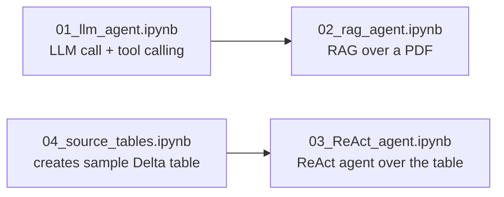
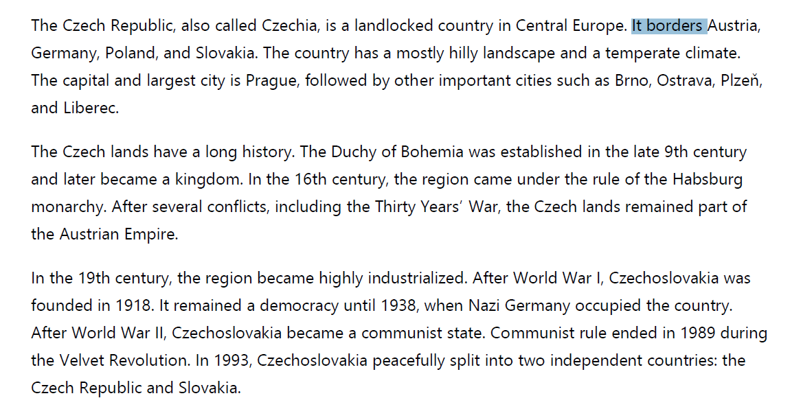

# Databricks Agent Notebooks

This folder contains a set of small, progressive Databricks notebooks that show how to build LLM agents on Databricks: starting from a plain LLM call, adding tool calling, then a RAG (Retrieval-Augmented Generation) pipeline, and finally a ReAct-style agent that queries a Delta table through custom tools.

## `01_llm_agent.ipynb`
Basic setup notebook and the simplest possible agent.
- Installs `databricks-openai` / `databricks-agents` and auto-detects an available Databricks LLM serving endpoint.
- Sends a first plain prompt to the LLM via `run_llm()` (e.g. "What's the capital of Brasil?" → "Brasília").
- Extends this to a tool-calling agent (`run_agent()`) that lets the model call the built-in `system.ai.python_exec` code-interpreter tool, e.g. "What is the square root of 9?" → model runs Python → answers `3.0`.

**Data source:** none — no external data, just free-text prompts sent straight to the LLM.

## `02_rag_agent.ipynb`
A minimal Retrieval-Augmented Generation (RAG) pipeline over a PDF document.
- Extracts text from a PDF (`rag_file.pdf`, a short text about the Czech Republic) using `pypdf`.
- Chunks the text with `RecursiveCharacterTextSplitter` (chunk size 400, overlap 150).
- Embeds each chunk with `sentence-transformers` (`all-MiniLM-L6-v2`) and saves chunks + embeddings to a Delta table (`rag_emb`).
- Implements `rag_answer()`: finds the most relevant chunks via cosine similarity, then asks the LLM to answer **only** from that context.
- Tested with in-context questions (correctly answered, e.g. "When did Czechoslovakia split?" → 1993) and an out-of-context question ("How much milk do I need for a cake?" → "I don't know").

**Data source:** a PDF at `/Volumes/agent/default/rag_volume/rag_file.pdf` — its text is what gets chunked and embedded:

*Source text used for chunking and embedding in the RAG example.*

## `03_ReAct_agent.ipynb`
A ReAct-style agent with custom business tools backed by a Delta table.
- Defines three Python functions over a `product` / `price` / `quantity` Delta table: `max_revenue_product`, `average_price`, `total_revenue`.
- Exposes them as OpenAI-style tool specs and dispatches tool calls with `call_tool()`.
- Runs a multi-step tool-calling loop (`run_agent_chat_step`) that keeps conversation history, so follow-up questions build on previous results — e.g. "difference between total revenue and average price" followed by "now add 500 to that".
- Requires the Delta table created by `04_source_tables.ipynb` to already exist.

**Data source:** the `<catalog>.<schema>.delta_table` Delta table created by `04_source_tables.ipynb` — same 3 rows shown below.

## `04_source_tables.ipynb`
Small helper notebook that creates the sample data used by `03_ReAct_agent.ipynb`.
- Builds a tiny Pandas DataFrame with 3 products (`price`, `quantity`) and writes it as a Delta table (`<catalog>.<schema>.delta_table`) in Unity Catalog.
- Run this once before `03_ReAct_agent.ipynb`.

**Data source:** hardcoded dummy data defined right in the notebook — the full table (this is also what `03_ReAct_agent.ipynb` reads):

| product | price | quantity |
|---------|-------|----------|
| A       | 100   | 1        |
| B       | 200   | 4        |
| C       | 300   | 2        |
